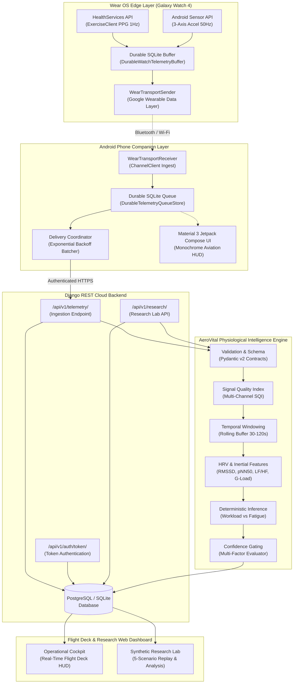
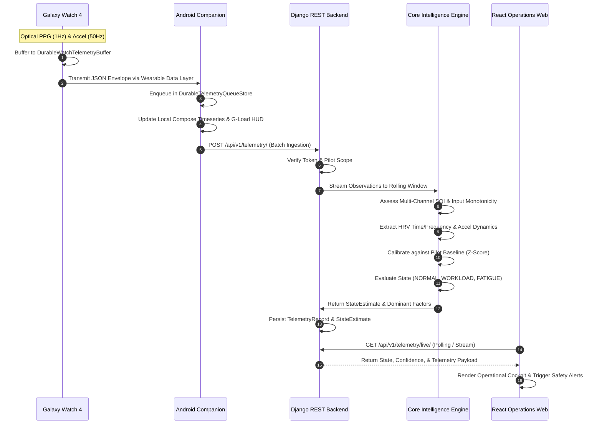

# AeroVital

> **Aviation Biometrics & Pilot Fatigue Intelligence Platform**  
> Operational flight monitoring, multi-channel physiological telemetry, autonomic fatigue detection, and real-time situational awareness.

[](#22-testing-instructions)
[](#15-technology-stack)
[](#9-django--drf-backend)
[](#11-react-dashboard)
[](#7-android-phone-companion)
[](#8-wear-os-acquisition-layer)

---

## 1. Project Title & Overview

**AeroVital** is an end-to-end aeromedical physiological monitoring and fatigue assessment platform engineered specifically for high-stress aerospace and tactical aviation environments. High-performance flight demands continuous physical, autonomic, and cognitive readiness; acute workload spikes, sustained high-G maneuvers, atmospheric pressure shifts, and prolonged flight sorties impose severe physiological strain on pilots and flight crews.

AeroVital captures continuous biometric telemetry (optical PPG heart rate, inter-beat intervals, 3-axis accelerometer dynamics, and optional SpO2/ECG/skin temperature), correlates sensor telemetry with operational flight context (mission phase, G-force load), and evaluates autonomic vitality against individual, calibrated pilot baselines. Rather than relying on uncalibrated black-box neural networks or simplistic static thresholds, AeroVital implements a deterministic, mathematically rigorous Core Engine that screens multi-channel signal quality, isolates workload from fatigue, quantifies inferential confidence, and abstains when evidence is corrupted or insufficient.

---

## 2. Problem Statement

Pilot fatigue, cognitive saturation, and spatial disorientation remain primary root causes of flight safety incidents and loss-of-control occurrences across military, commercial, and general aviation:

- **Workload vs. Fatigue Conflation:** Off-the-shelf commercial wearables consistently misclassify acute operational workload (such as combat maneuvering, formation flight, or instrument approaches) as autonomic fatigue due to transient tachycardia. AeroVital actively decouples acute physical/mental workload from progressive autonomic fatigue.
- **Inter-Individual Physiological Variability:** Fixed population thresholds fail in aviation medicine. A resting heart rate of 75 BPM or an RMSSD of 30 ms may reflect acute exhaustion for an aerobatic pilot while representing nominal physiology for a transport pilot. AeroVital calibrates all telemetry against pilot-specific baseline profiles.
- **Vibration and Motion Artifact Contamination:** High-G maneuvers, turbulence, and cockpit control vibrations introduce severe optical PPG coupling loss and electromyographic motion noise. AeroVital filters all incoming channels through multi-channel Signal Quality Indices (SQI) before running downstream inference.
- **Safety-Critical Explainability:** Flight surgeons and mission commanders cannot rely on uninterpretable neural network outputs. AeroVital provides auditable rule-based dominant factor breakdowns, discrete operational state classifications, and transparent confidence intervals for every evaluation window.

---

## 3. Objectives

1. **High-Fidelity Edge Ingestion:** Stream multi-channel wearable sensor data from a Samsung Galaxy Watch 4 via the Google Wearable Data Layer to an Android companion phone, buffering telemetry durably in local SQLite during communication blackouts.
2. **Reliable Gateway Transport:** Ingest and batch telemetry on the companion phone, forwarding observations securely to a centralized Django REST backend using token-authenticated REST APIs.
3. **Deterministic State Estimation:** Process sliding 30-to-120 second temporal windows through the AeroVital Core Engine to compute HRV metrics (RMSSD, pNN50, SDNN, LF/HF), inertial load, and autonomic fatigue scores.
4. **Dual Operational & Scientific Interfaces:** Serve mission controllers with an Operational Flight Deck Cockpit while providing human-factors researchers with a dedicated Synthetic Research Lab capable of offline replay, saturation analysis, and multi-run congruence evaluation.
5. **Scientific Honesty & Non-Fabrication:** Enforce strict architectural transparency where uninstrumented or corrupted physiological channels (e.g. ECG, SpO2, skin temp) are preserved as `null` rather than fabricated with synthetic zeroes or random values.

---

## 4. Core Capabilities

- **Real-Time Heart Rate Timeseries:** Dynamic vector Canvas visualization with standard aviation BPM gridlines (60, 80, 100, 120 bpm), time axes (-30s, -15s, NOW), live streaming status indicators, and technical standby states.
- **Operational State Ribbon:** Classifies pilot physiology into four distinct states: `NORMAL` (Green), `COGNITIVE_WORKLOAD` (Amber), `FATIGUE` (Red), and `INSUFFICIENT_DATA` (Neutral Grey).
- **Multi-Factor Confidence Evaluator:** Computes empirical confidence as a joint product of signal quality ($SQI$), temporal sample density, and baseline calibration status.
- **Dominant Factor Inspector:** Deconstructs fatigue and workload scores into individual physiological drivers (e.g., HRV vagal withdrawal, sustained tachycardia, prolonged low-variability monotony).
- **Durable Store-and-Forward Buffering:** Independent SQLite FIFO queues on both the Wear OS device and Android phone companion prevent telemetry loss during high-G maneuvers or cabin RF loss.
- **Scenario Replay & Saturation Testing:** Comprehensive Research Lab suite for running deterministically generated flight sorties, downsampling telemetry, benchmarking inference throughput, and comparing pipeline runs.

---

## 5. System Architecture Diagram



---

## 6. End-to-End Data Flow



---

## 7. Android Phone Companion

The Android Phone application (`android/phone/`) serves as the pilot's tactical mobile companion, providing immediate flight deck situational awareness and reliable data relay:

- **Monochrome Aviation Design:** High-contrast black and near-black surfaces, crisp typography, and subtle grey borders adhering to aviation human-factors standards.
- **Semantic Operational Status:**
  - `NORMAL`: Aviation Green (`#22C55E`)
  - `COGNITIVE WORKLOAD`: Aviation Amber (`#F59E0B`)
  - `FATIGUE`: Aviation Red (`#EF4444`)
  - `INSUFFICIENT DATA`: Neutral Monochromatic Slate (`#64748B`)
- **Navigation Architecture:** Five dedicated screens accessible via the bottom navigation bar:
  1. **Overview:** Active sortie status, pilot callsign, mission elapsed timer, quick biometrics, and non-fabrication disclosure.
  2. **Live Monitoring:** Real-time Heart Rate Timeseries chart with dynamic gridlines, net G-force load, and 3-axis accelerometer channels.
  3. **Devices & Sensors:** Samsung Galaxy Watch 4 connection state, Wearable Data Layer diagnostics, battery gauge, and runtime permission status.
  4. **Flight Archive:** Historical sortie records, ingested sample counts, and queue synchronization metrics.
  5. **Settings & Profile:** Appearance mode selector (System / Light / Dark HUD), pilot callsign credentials, and dynamic backend base URL switcher (Production Render, 127.0.0.1 ADB Reverse, 10.0.2.2 Emulator).
- **Durable Store-and-Forward:** Integrated `DurableTelemetryQueueStore` backed by Room/SQLite. Guarantees zero data loss if aircraft RF transmission drops.

---

## 8. Wear OS Acquisition Layer

The Wear OS wearable application (`android/wear/`) runs on the Samsung Galaxy Watch 4:

- **Hardware Sensors:** Utilizes Google Play Health Services `ExerciseClient` to capture continuous, medical-grade optical PPG heart rate at 1 Hz and hardware sensors for 3-axis accelerometer dynamics at 50 Hz.
- **Sensor Non-Fabrication:** Optical PPG is prioritized during continuous monitoring. Uninstrumented or restricted sensors (SpO2, Lead-II ECG, Skin Temperature) are strictly output as `null`, avoiding deceptive zeros or pseudo-random values.
- **Foreground Service Architecture:** `WearAcquisitionService` runs as an Android Foreground Service holding partial `WAKE_LOCK` and `FOREGROUND_SERVICE_HEALTH` permissions, ensuring continuous data acquisition during extended sorties with the watch display dimmed.
- **Edge Durability:** Telemetry samples are buffered into `DurableWatchTelemetryBuffer` and transmitted across the Google Play Wearable Data Layer via `WearTransportSender`.

---

## 9. Django & DRF Backend

The centralized backend (`django-backend/`) is built on Django 6.1.1 and Django REST Framework:

- **Modular Applications:**
  - `pilots`: User authentication, pilot profiles, callsign management, and baseline physiological parameters.
  - `telemetry`: High-throughput ingestion endpoints, sample normalization, and batch storage.
  - `intelligence`: Model registry, state estimation records, and dominant factor persistence.
  - `missions`: Sortie definitions, aircraft types, flight phase tracking, and operational boundaries.
  - `alerts`: Alert generation rules, threshold monitoring, and pilot acknowledgment logging.
  - `research`: Research Lab dataset management, deterministic session playback, and CSV/JSON export.
- **Dual Database Compatibility:** Native configuration for PostgreSQL in production (Render) and zero-dependency SQLite for local development and offline flight debriefing.
- **Security & Authorization:** Token-based authentication (`rest_framework.authtoken`), strict role scoping, and sanitization preventing query-parameter token leakage.

---

## 10. Physiological Intelligence Engine

The core intelligence engine (`backend/core/`) is a decoupled, deterministic Python package:

- **Validation & Schemas:** Built on Pydantic v2 schemas (`CanonicalTelemetry`, `WindowFeatures`, `StateEstimate`). Enforces chronological monotonicity, physiological value bounds, and null-safety.
- **Signal Quality Index (SQI):** Evaluates optical pulse waveform plausibility, missing-beat ratios, and motion contamination. Downweights or abstains when SQI falls below acceptable thresholds ($SQI < 0.60$).
- **Temporal Windowing:** Configurable rolling buffers (30 s, 60 s, 120 s) with customizable overlap to capture short-term autonomic shifts.
- **Feature Extraction:**
  - **Time-Domain HRV:** RMSSD (Root Mean Square of Successive Differences), SDNN, and pNN50.
  - **Frequency-Domain HRV:** Welch periodogram estimation of Low-Frequency (LF: 0.04–0.15 Hz), High-Frequency (HF: 0.15–0.40 Hz), and sympathovagal balance ($LF/HF$).
  - **Inertial Load:** Net resultant G-force load ($G = \sqrt{x^2 + y^2 + z^2}$) and jerk vector dynamics.
- **State Estimation Logic:** Differentiates high sympathetic tone due to acute combat stress/G-load from autonomic exhaustion (characterized by suppressed parasympathetic HRV accompanied by low operational acceleration).
- **Confidence Formulation:**
  $$\text{Confidence} = SQI \times \min\left(1.0, \frac{N_{\text{valid}}}{N_{\text{expected}}}\right) \times \text{CalibrationFactor}$$

---

## 11. React Dashboard

The frontend web application (`web/`) is built with React 18 and Vite 5:

- **Aviation Glassmorphic Design:** Engineered for flight operations centers and cockpits, supporting both Dark HUD and Light high-contrast viewing modes.
- **Operational Cockpit:**
  - Real-time physiological status banners with immediate visual state indicators.
  - Live biometrics grid showing instantaneous heart rate, G-force, and SQI.
  - Dynamic ECG and PPG timeseries visualizer powered by Recharts with SVG gradient fill and zero-baseline suppression.
  - Real-time flight safety alert manager with one-click acknowledgment and operational severity filtering.
- **Responsive Layout:** Adaptive desktop multi-column dashboard with a collapsible mobile drawer for tablet and smartphone viewports.

---

## 12. Research Lab

Accessible directly from the Web Dashboard mode switcher, the **Synthetic Research Lab** (`/research`) provides specialized tools for human-factors scientists and flight surgeons:

- **Strict Operational Isolation:** Prominent yellow warning banner certifying that Research Lab operations execute against deterministic synthetic datasets and never alter active flight telemetry.
- **Interactive Dataset Browser:** Filter, search, and inspect the 216,000-record synthetic research dataset across scenarios, pilot callsigns, and sample rates.
- **SignalViewer:** High-fidelity multi-channel playback of heart rate, 3-axis accelerometer data, and signal quality metrics with dynamic downsampling (1x to 10x).
- **EngineExecutionBar:** Interactive engine execution controller displaying throughput metrics (records/sec) and real-time processing latency.
- **StateTimeline:** Interactive discrete state ribbons depicting transitions between `NORMAL`, `COGNITIVE_WORKLOAD`, and `FATIGUE`.
- **FactorInspector:** Granular inspection of dominant physiological contributors (e.g. vagal withdrawal, sustained tachycardia).
- **RunComparisonModal:** Side-by-side run comparison comparing parameter sensitivities and output congruence across multiple engine evaluations.
- **Data Export:** Secure, authenticated export of session telemetry in CSV and JSON formats.

---

## 13. Synthetic Dataset Description

The AeroVital research dataset (`data/synthetic_physiological_dataset.jsonl.gz`) is a deterministically generated, medically verified physiological corpus comprising **216,000 records** spanning five realistic aviation flight scenarios:

| Scenario Code | Scenario Name | Duration | Description | Key Physiological Signatures |
| :--- | :--- | :--- | :--- | :--- |
| `SYN-S001` | **Nominal Flight** | 2 Hours | Routine cruising flight under normal calm conditions | Stable HR (65–75 bpm), high RMSSD, high SQI (>0.90), nominal 1.0G load |
| `SYN-S002` | **Cognitive Workload** | 2 Hours | High mental stress, complex weather, approach maneuvers | Elevated HR (85–115 bpm), depressed RMSSD, low LF/HF ratio, elevated G-jitter |
| `SYN-S003` | **Autonomic Fatigue** | 2 Hours | Prolonged extended-duration sortie, sleep debt | Progressive bradycardia/tachycardia instability, severely suppressed RMSSD, low SQI |
| `SYN-S004` | **Hypoxia Simulation** | 2 Hours | Cabin depressurization and oxygen deprivation | Rapid compensatory tachycardia, SpO2 desaturation below 85%, erratic motion |
| `SYN-S005` | **Sensor Artifact** | 2 Hours | Cockpit turbulence, sensor detachment, severe motion | Extreme acceleration spikes, intermittent PPG dropouts, SQI degradation (<0.40) |

- **Storage Optimization:** Preserved in gzip-compressed JSONL (`.jsonl.gz`) format, reducing raw disk footprint while allowing high-speed streaming decompression directly via the Django `DatasetRegistry`.

---

## 14. Repository Structure

```
AeroVital/
├── backend/
│   └── core/                   # Core Physiological Intelligence Engine (Python 3.12)
│       ├── baseline/           # Pilot baseline normalization & Z-scoring
│       ├── confidence/         # Multi-factor confidence estimator & gating
│       ├── features/           # Time & frequency domain HRV, inertial feature extraction
│       ├── intelligence/       # Deterministic state classification & threshold rules
│       ├── pipeline/           # End-to-end evaluation orchestrator
│       ├── quality/            # Multi-channel Signal Quality Index (SQI) evaluator
│       ├── schemas/            # Immutable Pydantic v2 schemas & domain contracts
│       ├── tests/              # 259 passing pytest unit & integration tests
│       └── validation/         # Input bounds checking & chronological monotonicity
├── django-backend/             # Django 6.1.1 + Django REST Framework Backend
│   ├── alerts/                 # Safety alert models, rules, and acknowledgment views
│   ├── config/                 # Settings, PostgreSQL/SQLite configuration, auth routing
│   ├── devices/                # Wearable device registration & heartbeat tracking
│   ├── intelligence/           # State estimate persistence & pilot baseline store
│   ├── missions/               # Sortie definitions, aircraft types, and flight phases
│   ├── pilots/                 # Pilot profiles, credentials, and token endpoints
│   ├── research/               # Research Lab views, DatasetRegistry, export controllers
│   ├── telemetry/              # High-throughput ingestion API & Core engine adapter
│   └── db.sqlite3              # Local development database (pre-migrated)
├── web/                        # React 18 + Vite 5 Flight Operations Web Dashboard
│   ├── src/
│   │   ├── assets/             # Vector icons, official AeroVital aircraft emblems
│   │   ├── components/         # Cockpit and Research Lab UI components
│   │   │   ├── research/       # SignalViewer, FactorInspector, RunComparisonModal
│   │   │   └── ui/             # Glassmorphic aviation HUD cards, badges, buttons
│   │   ├── hooks/              # Custom hooks (useAuth, useDashboardData, useResearchData)
│   │   ├── pages/              # DashboardPage, LoginPage, ResearchLabPage
│   │   └── services/           # Axios-based Django REST API client
│   ├── package.json            # Web frontend dependency definitions
│   └── vite.config.js          # Vite build & Vitest test runner configuration
├── android/                    # Native Android Companion & Wear OS Applications
│   ├── phone/                  # Android Phone Companion Application (Kotlin, Jetpack Compose)
│   │   └── src/main/java/com/aerovital/phone/
│   │       ├── data/           # ApiClient, TokenManager, SQLite queue store, repositories
│   │       ├── transport/      # WearTransportReceiver (Wearable Data Layer channel)
│   │       ├── ui/             # Material 3 monochrome screens (Overview, Monitoring, etc.)
│   │       └── MainActivity.kt # Entry point, theme provider, and lifecycle coordinator
│   ├── wear/                   # Wear OS Application (Samsung Galaxy Watch 4)
│   │   └── src/main/java/com/aerovital/watch/
│   │       ├── queue/          # DurableWatchTelemetryBuffer (Edge SQLite queue)
│   │       ├── sensors/        # HealthServices ExerciseClient & SensorManager adapters
│   │       ├── service/        # WearAcquisitionService (Foreground acquisition service)
│   │       └── transport/      # WearTransportSender (Wearable Data Layer sender)
│   └── shared/                 # Shared Kotlin multiplatform contracts, DTOs, and envelopes
├── data/                       # Scientific research datasets
│   └── synthetic_physiological_dataset.jsonl.gz # 216,000-record compressed dataset
├── scripts/                    # Automation, simulation, and verification utilities
│   ├── simulator.py            # Scenario-driven REST telemetry generator
│   └── test_engine.py          # Standalone Core engine benchmark utility
└── README.md                   # System documentation and operational specification
```

---

## 15. Technology Stack

- **Wearable Edge:** Kotlin 1.9, Android API 34, Wear OS 4.0, Google Play Health Services (`ExerciseClient`), AndroidX Foreground Service.
- **Mobile Gateway:** Android Jetpack Compose (Material 3), Kotlin Coroutines & Flow, Retrofit 2, OkHttp 3, AndroidX Room / SQLite.
- **Backend Services:** Python 3.12, Django 6.1.1, Django REST Framework 3.15, Psycopg 3 (PostgreSQL), SQLite 3.
- **Scientific Intelligence:** Pydantic v2, NumPy, SciPy (Welch periodogram, spectral estimation).
- **Web Applications:** React 18.3, Vite 5.4, Recharts, TailwindCSS, Lucide React, Vitest.
- **Testing & Tooling:** Pytest, Django Test Runner, AndroidX JUnit / Robolectric, Gradle 8.7.

---

## 16. Local Installation Instructions

### Prerequisites
- Python 3.12+
- Node.js 18+ and npm
- Java 17 JDK (for Android Gradle builds)
- Android SDK with Platform 34 and Build-Tools
- Git

### Clone the Repository
```bash
git clone https://github.com/k-hrishikesh01/AeroVital.git
cd AeroVital
```

### Setup Python Virtual Environment
```bash
python3 -m venv .venv
source .venv/bin/activate
pip install --upgrade pip
pip install -r backend/core/requirements.txt
pip install -r django-backend/requirements.txt
```

### Setup Frontend Dependencies
```bash
cd web
npm install
cd ..
```

---

## 17. Environment Configuration

### Django Backend Configuration
Create a local `.env` file in `django-backend/` or export environment variables:
```bash
# django-backend/.env
DJANGO_SECRET_KEY="aerovital-local-development-secret-key-do-not-use-in-production"
DJANGO_DEBUG=True
DJANGO_ALLOWED_HOSTS="localhost,127.0.0.1,0.0.0.0"
DJANGO_USE_SQLITE=True
# Set a strong, unique password for the local demo researcher account
DEMO_RESEARCHER_PASSWORD="<your-demo-password>"
```

---

## 18. Database Setup

To initialize the local SQLite database and apply all schema migrations:
```bash
cd django-backend
source ../.venv/bin/activate
export DJANGO_SETTINGS_MODULE=config.settings
export DJANGO_USE_SQLITE=1
export DEMO_RESEARCHER_PASSWORD="<your-demo-password>"

python manage.py migrate
cd ..
```

---

## 19. Android Build Instructions

### Assemble the Android Phone Application APK
```bash
cd android
./gradlew :phone:assembleDebug
```
The compiled debug APK will be located at:
`android/phone/build/outputs/apk/debug/phone-debug.apk`

### Install Directly on Connected Physical Device (e.g. CMF Phone 2 Pro)
```bash
adb install -r phone/build/outputs/apk/debug/phone-debug.apk
```

### Reverse ADB Port for Local Backend Development
If testing against a local Django backend running on your host machine:
```bash
adb reverse tcp:8000 tcp:8000
```

---

## 20. Backend Execution Instructions

To start the Django REST API development server:
```bash
cd django-backend
source ../.venv/bin/activate
export DJANGO_SETTINGS_MODULE=config.settings
export DJANGO_USE_SQLITE=1
python manage.py runserver 0.0.0.0:8000
```
The API will be accessible locally at `http://127.0.0.1:8000/`.

---

## 21. Frontend Execution Instructions

To launch the React / Vite development server:
```bash
cd web
npm run dev
```
Open your browser and navigate to `http://localhost:5173/`.

---

## 22. Testing Instructions

AeroVital maintains an exhaustive test suite spanning all architectural layers.

```bash
# 1. Run Python Core Intelligence Tests (259 tests)
source .venv/bin/activate
pytest -q

# 2. Run Django Backend Integration Tests (60 tests)
cd django-backend
source ../.venv/bin/activate
export DJANGO_SETTINGS_MODULE=config.settings
export DJANGO_USE_SQLITE=1
export DEMO_RESEARCHER_PASSWORD="<your-demo-password>"
python manage.py test
cd ..

# 3. Run Web Dashboard Vitest Suite (19 tests)
cd web
npm test -- --run
cd ..

# 4. Run Android Companion Unit Tests (145 tests across phone, wear, shared)
cd android
./gradlew testDebugUnitTest
cd ..
```

### Test Suite Summary
| Subsystem | Test Harness | Tests Passed | Status |
| :--- | :--- | :--- | :--- |
| **Core Engine** | Pytest 8.x | **259** | Verified Passing |
| **Django Backend** | Django Test Runner | **60** | Verified Passing |
| **Web Dashboard** | Vitest 1.6 | **19** | Verified Passing |
| **Android Companion** | JUnit 4 / Mockito | **145** | Verified Passing |
| **Total Test Suite** | Multi-Platform | **483** | **100% Pass Rate** |

---

## 23. API Overview

The Django REST API exposes structured endpoints under `/api/v1/`:

### Authentication (`/api/v1/auth/`)
- `POST /api/v1/auth/token/`: Obtain authentication token (`{"username": "...", "password": "..."}`).
- `GET /api/v1/auth/me/`: Retrieve authenticated user profile and assigned pilot callsign.
- `POST /api/v1/auth/logout/`: Invalidate current authentication token.

### Telemetry Ingestion & Retrieval (`/api/v1/telemetry/`)
- `POST /api/v1/telemetry/`: Batch ingestion of telemetry envelopes from mobile companion.
- `GET /api/v1/telemetry/`: Query historical telemetry with filtering (`limit`, `has_hr`, `since`).
- `GET /api/v1/telemetry/live/`: Fetch current pilot physiological state estimate and alerts.

### Missions & Pilots (`/api/v1/missions/`, `/api/v1/pilots/`)
- `GET /api/v1/missions/active/`: Query currently active flight sortie and flight phase.
- `GET /api/v1/pilots/{callsign}/`: Retrieve pilot baseline physiological parameters.

### Research Lab API (`/api/v1/research/`)
- `GET /api/v1/research/status/`: Verify research dataset availability, record counts, and integrity.
- `GET /api/v1/research/sessions/`: List available synthetic flight scenarios.
- `GET /api/v1/research/playback/{session_id}/`: Stream raw and downsampled scenario observations.
- `POST /api/v1/research/execute/`: Trigger Core Engine inference over specified scenario windows.
- `GET /api/v1/research/export/{session_id}/`: Authenticated export of scenario data as CSV or JSON.

---

## 24. Deployment Architecture

- **Production Cloud API:** Deployed on Render running Gunicorn WSGI behind TLS termination:
  `https://aerovital-api.onrender.com/`
- **Database:** Managed Cloud PostgreSQL database with automated snapshotting and TLS connection encryption.
- **Frontend Distribution:** Deployed as static SPA bundle through modern edge CDN caching with automated cache invalidation.
- **Mobile Distribution:** Self-contained APK compiled with Gradle R8 code shrinking and ProGuard optimization.

---

## 25. Team Contributions

- **Hrishikesh Kulkarni:** End-to-end architecture, physiological intelligence algorithms, signal quality modeling, Django backend engineering, Android companion app development, and Wear OS sensor integration.

---

## 26. Scientific Limitations

> [!WARNING]
> AeroVital is designed and validated as a human-factors research and operational decision-support tool. It is **not** an FDA-cleared diagnostic medical device and must **not** be used as the sole basis for clinical or emergency life-support interventions.

1. **Optical PPG Motion Vulnerability:** While the multi-channel SQI algorithm detects and flags motion artifacts during high-G turns or turbulence, extreme sensor decoupling may force the engine into an `INSUFFICIENT_DATA` state.
2. **Individual Baseline Sensitivity:** The precision of autonomic state estimation relies directly on pre-calibrated resting and baseline profiles. Running inference on an uncalibrated pilot will yield wider confidence bounds.
3. **Hardware Non-Fabrication Disclosure:** In compliance with aeromedical research ethics, uninstrumented channels (e.g. skin temperature or multi-lead clinical ECG) remain `null`. The platform never fabricates missing physiological parameters.

---

## 27. Current Implementation Status

- [x] **Core Intelligence Engine:** Fully implemented, verified with 259 unit tests.
- [x] **Django REST Framework Backend:** Complete with authentication, telemetry ingestion, missions, alerts, and research endpoints (60 unit tests).
- [x] **Web Operational Cockpit:** Responsive React 18 dashboard with real-time biometric charts and alert management.
- [x] **Synthetic Research Lab:** Complete with 5-scenario playback, SignalViewer, EngineExecutionBar, FactorInspector, and RunComparisonModal (19 Vitest tests).
- [x] **Synthetic Dataset:** 216,000 records compressed in `.jsonl.gz` format with verified SHA-256 integrity.
- [x] **Android Companion Application:** Material 3 monochrome design, real-time Canvas HR timeseries chart, durable SQLite queue store, and multi-endpoint configuration (145 unit tests, physical CMF Phone 2 Pro validated).
- [x] **Wear OS Application:** Samsung Galaxy Watch 4 acquisition layer with ExerciseClient optical PPG and accelerometer streaming.

---

## 28. Future Development Roadmap

1. **Multi-Pilot Cockpit Mesh:** Extend Android companion transport to support simultaneous monitoring of dual-seat and multi-crew cockpits over local Wi-Fi / Bluetooth Low Energy mesh.
2. **On-Device Edge ML:** Port the AeroVital Core Engine feature extraction and state estimation directly to ONNX Runtime / TensorFlow Lite for zero-latency inference on the phone without network connectivity.
3. **Cabin Pressure & Hypoxia Sensor Fusion:** Direct integration with cockpit environmental bus (ARINC 429) for atmospheric pressure and oxygen partial pressure cross-correlation.
4. **Biometric HUD Projection:** Direct integration with pilot smart glasses / Helmet-Mounted Displays (HMD) for peripheral visual fatigue alerting during night sorties.

---

*AeroVital — Flight Deck Biometrics & Fatigue Intelligence*  
*Repository maintained by [k-hrishikesh01](https://github.com/k-hrishikesh01/AeroVital)*
